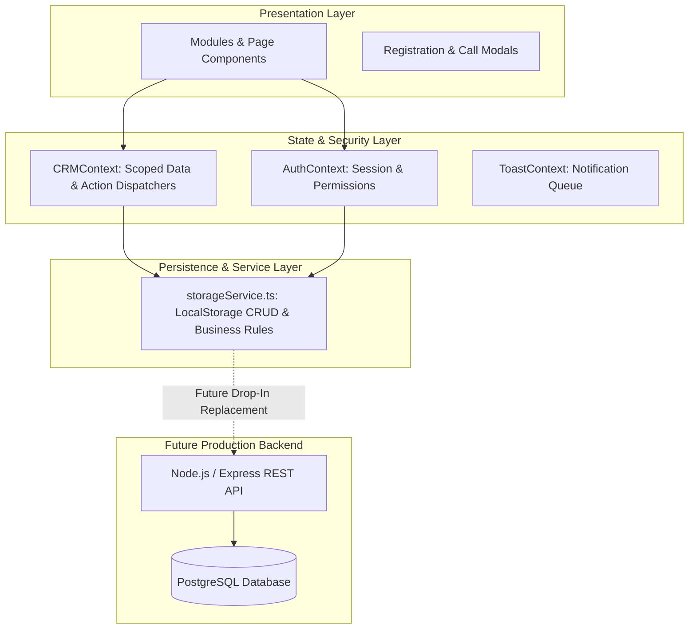

# Frontend Architecture & Technical Design

**Project:** Sales CRM — Client Presentation Prototype  
**Scope:** Architectural Patterns, State Flow, Granular RBAC, Responsive Layout & Code Structure  

---

## 1. Technology Choices & Design Rationale

- **React 18 & TypeScript 5**: Enforces strict compile-time type safety across all domain entities (Users, Permissions, Leads, Calls, Follow-ups, Sales, Campaigns).
- **Vite 5**: High-speed build tooling with Hot Module Replacement (HMR) and optimized Rollup chunking.
- **Tailwind CSS**: Utility-first styling configured with an enterprise color palette matching modern SaaS leaders (Linear, Stripe):
  - Sidebar: `#171717` (Deep Slate / Neutral)
  - Canvas: `#F8FAFC` (Clean Light Gray)
  - Brand Accent: `#EA580C` (Vibrant High-Contrast Orange)
  - Subtle Borders: `#E2E8F0` / `#E5E7EB`
- **Recharts**: Responsive SVG charting library customized for dark/light contrast, custom tooltips, and time-interval aggregations.
- **React Hook Form & Zod**: Schema validation for lead creation, staff registration, and profile updates.
- **date-fns**: Time formatting, duration calculations, and relative date resolution.
- **Vercel SPA Routing**: Custom `vercel.json` rewrite architecture ensuring edge CDN caching and deep route preservation.

---

## 2. Directory Structure

```
src/
├── types/
│   └── crm.ts               # Core domain TypeScript models & 32-permission matrix
├── data/
│   └── mockData.ts          # Realistic seed data for Indian real estate sales
├── services/
│   └── storageService.ts    # Centralized storage abstraction (CRUD + LocalStorage persistence)
├── context/
│   ├── AuthContext.tsx      # Current user session, role switching, hasPermission helpers
│   ├── CRMContext.tsx       # Reactive data store, actions, computed KPIs, scoped entities
│   └── ToastContext.tsx     # Toast notification system
├── utils/
│   ├── cn.ts                # ClassName merger (clsx + twMerge)
│   ├── formatters.ts        # Currency (INR ₹), duration (mm:ss), dates
│   └── exportCsv.ts         # Generic client-side CSV generator
├── components/
│   ├── ui/                  # Reusable low-level primitives (Button, Input, Select, Badge, Card, Modal)
│   ├── common/              # Higher-level widgets (StatusBadge, StatCard, CallSimulationModal, PermissionDeniedState)
│   ├── charts/              # Recharts components (LeadTrend, StatusPie, CallingBar, StaffPerf, RevenueTrend)
│   └── layout/              # Mobile off-canvas Sidebar, Header with scalable User Switcher, Breadcrumbs, AppLayout
├── modules/
│   ├── auth/                # LoginPage & demo account cards
│   ├── dashboard/           # MasterDashboardPage, StaffDashboardPage, DashboardRouter
│   ├── leads/               # LeadListPage, LeadDetailPage, LeadAssignmentPage (Dynamic Workload Cards)
│   ├── calling/             # CallManagementPage & Telephony Log
│   ├── followups/           # FollowUpManagementPage & Calendar Planner
│   ├── team/                # TeamManagementPage & 2-step Staff Registration Modal
│   ├── attendance/          # AttendanceSessionsPage & Active Sessions
│   ├── sales/               # SalesRevenuePage & Closed Ledger
│   ├── marketing/           # MarketingCampaignsPage & Meta Connect Modal
│   ├── website-analytics/   # WebsiteAnalyticsPage & Reverse-IP Logs
│   ├── reports/             # ReportsPage with CSV exports & Print view
│   ├── integrations/        # IntegrationsPage with Gateway blueprints & Sandbox badges
│   ├── activity-logs/       # ActivityLogsPage & Audit Trail
│   └── settings/            # SettingsPage & Database Reset
├── routes/
│   └── AppRoutes.tsx        # React Router DOM config with PermissionRoute guards
├── App.tsx                  # Root Providers wrapper
├── index.css                # Tailwind directives & print styling
└── main.tsx                 # DOM Entry point
```

---

## 3. State Management & Layered Architecture

The application is structured into four distinct, decoupled layers:



1. **Storage Layer (`storageService.ts`)**:
   - Manages LocalStorage read/write operations with JSON serialization.
   - Encapsulates side-effects (e.g., logging an outbound call also increments the lead attempt counter, adjusts total talk time, updates the lead status, and appends an activity log).
   - Designed to be swapped 1:1 with an HTTP Axios/Fetch client connecting to a REST API.

2. **Context Layer (`CRMContext.tsx` & `AuthContext.tsx`)**:
   - Holds active memory state in React hooks.
   - Computes live Master KPIs and Staff KPIs dynamically via `useMemo`.
   - Evaluates user capabilities via `hasPermission(permission)`.
   - Exposes clean action dispatchers (`addLead`, `recordCall`, `assignLead`, `completeFollowUp`, `addSale`, `addStaff`, `updateStaff`).

3. **Presentation Layer (`modules/`)**:
   - Pure functional React components consuming context without direct LocalStorage coupling.

---

## 4. Granular Duty & Permission System Architecture

### 4.1 Domain Model (`src/types/crm.ts`)
Permissions are strongly typed as a 32-value union:
```typescript
export type Permission =
  | 'dashboard.view'
  | 'leads.view' | 'leads.view_all' | 'leads.create' | 'leads.edit' | 'leads.assign' | 'leads.archive' | 'leads.export'
  | 'calls.view' | 'calls.initiate' | 'calls.record_attempt' | 'calls.view_history' | 'calls.view_all_history'
  | 'followups.view' | 'followups.create' | 'followups.edit' | 'followups.complete' | 'followups.view_all'
  | 'sales.view' | 'sales.create' | 'sales.edit' | 'sales.view_revenue'
  | 'marketing.view' | 'campaigns.view' | 'campaigns.manage'
  | 'website_analytics.view' | 'website_analytics.export'
  | 'reports.view' | 'reports.export'
  | 'team.view' | 'team.manage'
  | 'attendance.view_own' | 'attendance.view_all'
  | 'activity_logs.view';
```

### 4.2 Route Guards (`PermissionRoute` in `AppRoutes.tsx`)
Rather than relying on binary `MasterRoute` redirection, routes are guarded by specific required permissions:
```tsx
<Route
  path="/team"
  element={
    <PermissionRoute requiredPermission="team.manage">
      <TeamManagementPage />
    </PermissionRoute>
  }
/>
```
If unauthorized, the user is presented with the branded `PermissionDeniedState` component, displaying their current role, designation, missing permission key, and a button to return to their authorized workspace.

### 4.3 Data Scoping in Context
- **Lead Access**:
  ```typescript
  const accessibleLeads = useMemo(() => {
    if (isMaster || hasPermission('leads.view_all')) return leads;
    return leads.filter(l => l.assignedToId === currentUser?.id);
  }, [leads, isMaster, currentUser, hasPermission]);
  ```
- **Calling History**: If missing `calls.view_all_history`, records are filtered to `call.agentId === currentUser.id`.
- **Follow-ups**: If missing `followups.view_all`, items are filtered to `followup.assignedToId === currentUser.id`.

---

## 5. Mobile Responsive Architecture

- **Off-Canvas Sidebar Drawer**: On screens `< 768px`, the sidebar transitions into a fixed drawer (`fixed inset-y-0 left-0 z-50`) paired with a dark backdrop overlay (`bg-black/50 backdrop-blur-sm`).
- **Main Viewport Adjustment**: Replaced rigid left padding (`pl-16`) with `pl-0 md:pl-64` and `overflow-x-hidden` on the content container, completely eliminating mobile squish.
- **Horizontal Table Scrolling**: Data tables are wrapped in `w-full overflow-x-auto scrollbar-thin` with fixed minimum widths (`min-w-[700px]`), safeguarding column alignment and readability on mobile viewports (360px-430px).
- **Scalable Role Switcher**: Header dynamically switches between horizontal button pills (for <= 3 users on desktop) and a compact dropdown selector (for > 3 users or mobile screens).
