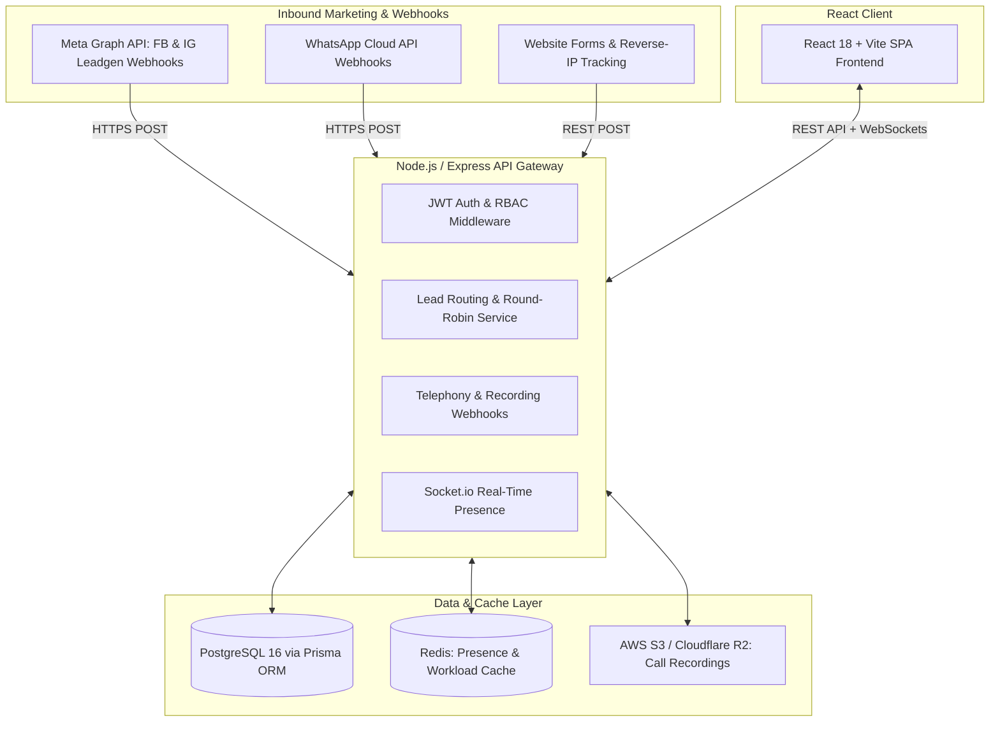

# Future Backend Architecture & Production Implementation Plan

**Project:** Sales CRM — Client Presentation Prototype  
**Scope:** Node.js, Express/NestJS, PostgreSQL, Prisma ORM, Granular RBAC, Webhooks & Telephony Integration  

---

## 1. System Architecture Overview



---

## 2. PostgreSQL Prisma Schema Design (Including Granular Duty & Permission RBAC)

The TypeScript interfaces defined in `src/types/crm.ts` map directly to this normalized relational schema:

```prisma
datasource db {
  provider = "postgresql"
  url      = env("DATABASE_URL")
}

generator client {
  provider = "prisma-client-js"
}

enum UserRole {
  MASTER
  STAFF
}

enum LeadStatus {
  NEW
  ASSIGNED
  CONTACTED
  INTERESTED
  FOLLOWUP
  CONVERTED
  LOST
  NOT_CONNECTED
}

enum LeadPriority {
  LOW
  MEDIUM
  HIGH
  URGENT
}

enum CallDirection {
  OUTGOING
  INCOMING
}

enum CallStatus {
  INITIATED
  RINGING
  ANSWERED
  COMPLETED
  NO_ANSWER
  BUSY
  FAILED
  CANCELLED
  REJECTED
}

model User {
  id           String        @id @default(uuid())
  name         String
  email        String        @unique
  passwordHash String
  phone        String
  designation  String        @default("Sales Executive")
  role         UserRole      @default(STAFF)
  department   String?
  avatarUrl    String?
  status       String        @default("active") // "active" | "inactive"
  createdAt    DateTime      @default(now())
  updatedAt    DateTime      @updatedAt

  // Granular Duties & Permissions
  permissions  UserPermission[]

  // CRM Domain Relationships
  assignedLeads Lead[]       @relation("AssignedLeads")
  calls         CallAttempt[]
  followUps     FollowUp[]
  sales         SalesRecord[]
  sessions      AttendanceSession[]
}

model UserPermission {
  id             String   @id @default(uuid())
  userId         String
  user           User     @relation(fields: [userId], references: [id], onDelete: Cascade)
  permissionKey  String   // e.g. "leads.assign", "calls.initiate", "sales.create"
  grantedAt      DateTime @default(now())

  @@unique([userId, permissionKey])
  @@index([userId])
}

model Lead {
  id                   String        @id @default(cuid())
  customerName         String
  phone                String
  email                String
  source               String        // facebook_ads, instagram_ads, whatsapp, website
  campaign             String
  interestedProduct    String
  status               LeadStatus    @default(NEW)
  priority             LeadPriority  @default(MEDIUM)
  city                 String?
  budget               Decimal?      @db.Decimal(12, 2)
  remarks              String        @db.Text
  totalAttempts        Int           @default(0)
  connectedAttempts    Int           @default(0)
  totalTalkTimeSeconds Int           @default(0)
  firstAttemptDate     DateTime?
  lastContactDate      DateTime?
  nextFollowUpDate     DateTime?
  createdAt            DateTime      @default(now())
  updatedAt            DateTime      @updatedAt

  assignedStaffId      String?
  assignedStaff        User?         @relation("AssignedLeads", fields: [assignedStaffId], references: [id])
  calls                CallAttempt[]
  followUps            FollowUp[]
  notes                LeadNote[]
  sales                SalesRecord[]
}

model CallAttempt {
  id              String        @id @default(cuid())
  leadId          String
  lead            Lead          @relation(fields: [leadId], references: [id], onDelete: Cascade)
  staffId         String
  staff           User          @relation(fields: [staffId], references: [id])
  direction       CallDirection @default(OUTGOING)
  status          CallStatus
  attemptNumber   Int
  startTime       DateTime      @default(now())
  endTime         DateTime?
  durationSeconds Int           @default(0)
  remarks         String        @db.Text
  recordingUrl    String?
}

model FollowUp {
  id              String        @id @default(cuid())
  leadId          String
  lead            Lead          @relation(fields: [leadId], references: [id], onDelete: Cascade)
  assignedStaffId String
  assignedStaff   User          @relation(fields: [assignedStaffId], references: [id])
  scheduledDate   DateTime
  scheduledTime   String
  remarks         String        @db.Text
  status          String        @default("pending")
  priority        String        @default("medium")
  createdAt       DateTime      @default(now())
}

model SalesRecord {
  id              String        @id @default(cuid())
  leadId          String
  lead            Lead          @relation(fields: [leadId], references: [id])
  assignedStaffId String
  assignedStaff   User          @relation(fields: [assignedStaffId], references: [id])
  product         String
  saleAmount      Decimal       @db.Decimal(14, 2)
  paymentStatus   String        @default("paid")
  invoiceNumber   String        @unique
  conversionDate  DateTime      @default(now())
  notes           String?
}

model AttendanceSession {
  id                          String    @id @default(cuid())
  staffId                     String
  staff                       User      @relation(fields: [staffId], references: [id])
  loginTime                   DateTime  @default(now())
  logoutTime                  DateTime?
  totalSessionDurationMinutes Int       @default(0)
  totalTalkTimeMinutes        Int       @default(0)
  idleTimeMinutes             Int       @default(0)
  status                      String    @default("active")
}

model LeadNote {
  id        String   @id @default(cuid())
  leadId    String
  lead      Lead     @relation(fields: [leadId], references: [id], onDelete: Cascade)
  authorId  String
  text      String   @db.Text
  createdAt DateTime @default(now())
}
```

---

## 3. Granular RBAC Middleware Specification

In Express.js or NestJS, endpoints will enforce identical capability keys to the frontend:

```typescript
// middleware/requirePermission.ts
export const requirePermission = (permission: string) => {
  return async (req: Request, res: Response, next: NextFunction) => {
    const user = req.user; // populated by JWT verification middleware
    if (user.role === 'MASTER') return next();

    const hasPerm = await prisma.userPermission.findUnique({
      where: {
        userId_permissionKey: {
          userId: user.id,
          permissionKey: permission,
        },
      },
    });

    if (!hasPerm) {
      return res.status(403).json({
        error: 'Forbidden',
        message: `Missing required permission: ${permission}`,
      });
    }

    next();
  };
};

// Example Express Route Enforcing Permission
router.post('/leads/:id/assign', requirePermission('leads.assign'), leadsController.assignLead);
router.post('/team/staff', requirePermission('team.manage'), teamController.createStaff);
router.get('/reports/export', requirePermission('reports.export'), reportsController.exportCSV);
```

---

## 4. REST API Specification

### Authentication & Users
- `POST /api/v1/auth/login`: Issue JWT token with user profile and assigned permissions.
- `GET /api/v1/auth/me`: Resolve current session.
- `GET /api/v1/users`: List sales representatives (Guarded by `team.view`).
- `POST /api/v1/users`: Create sales representative account (Guarded by `team.manage`).
- `PATCH /api/v1/users/:id`: Edit details, update duties, or deactivate account (Guarded by `team.manage`).
- `POST /api/v1/users/:id/reset-password`: Reset staff password (Guarded by `team.manage`).

### Lead Management & Allocation
- `GET /api/v1/leads`: Paginated list of leads with filtering by status, source, staff, and date range. If user lacks `leads.view_all`, automatically scopes to `assignedStaffId = req.user.id`.
- `POST /api/v1/leads`: Ingest new lead manually (Guarded by `leads.create`).
- `GET /api/v1/leads/:id`: Fetch complete lead dossier with call logs, timeline, and notes.
- `PATCH /api/v1/leads/:id`: Update lead status, priority, or remarks (Guarded by `leads.edit`).
- `POST /api/v1/leads/:id/assign`: Assign or reassign lead to sales staff (Guarded by `leads.assign`).
- `POST /api/v1/leads/round-robin`: Execute automated round-robin allocation across active staff (Guarded by `leads.assign`).

### Telephony & Calling
- `POST /api/v1/telephony/initiate-call`: Triggers WebRTC or click-to-call bridge between agent handset and customer (Guarded by `calls.initiate`).
- `POST /api/v1/telephony/webhooks/call-status`: Cloud telephony webhook (Exotel / Twilio) receiving duration, status, and recording URL.
- `GET /api/v1/calls`: List call history records. Scoped to agent unless possessing `calls.view_all_history`.

---

## 5. Meta Ads Real-Time Webhook Pipeline

1. **Webhook Endpoint Verification**:
   ```typescript
   app.get('/api/v1/webhooks/meta-leadgen', (req, res) => {
     const mode = req.query['hub.mode'];
     const token = req.query['hub.verify_token'];
     const challenge = req.query['hub.challenge'];
     if (mode === 'subscribe' && token === process.env.META_WEBHOOK_VERIFY_TOKEN) {
       return res.status(200).send(challenge);
     }
     return res.sendStatus(403);
   });
   ```

2. **Lead Notification Ingestion**:
   - Meta sends a POST request with `leadgen_id`, `form_id`, and `page_id`.
   - Node.js server validates the `X-Hub-Signature-256` HMAC header.
   - Server requests lead data using the Meta Graph API:
     `GET https://graph.facebook.com/v20.0/{leadgen_id}?access_token={PAGE_TOKEN}`.
   - Extracts customer name, phone number, email, and ad set parameters.
   - Stores lead in PostgreSQL.
   - If round-robin auto-allocation is active, selects the next eligible active sales representative and assigns the lead immediately.
   - Emits a WebSocket event (`socket.emit('lead:new', lead)`) to trigger real-time desktop notification on the assigned agent's browser screen.

---

## 6. Migration Guide (Frontend to Backend)

In `src/services/storageService.ts`:
Replace each static method with an HTTP client call (e.g. `axios.get('/api/v1/leads')`). Since the frontend components consume data exclusively through `useCRM()` and `useAuth()`, **zero component redesign is necessary** during backend switchover.
