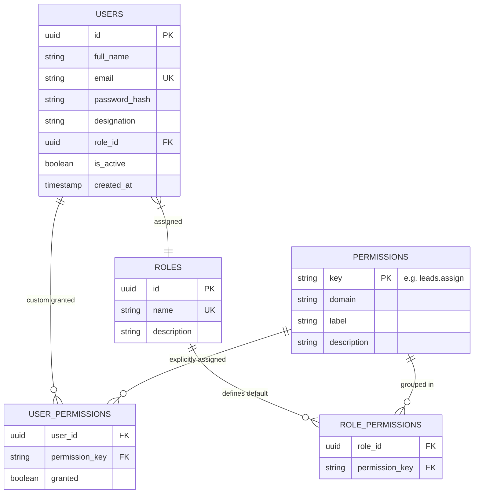

# Granular Duty & Permission Management Architecture

**Project:** Sales CRM — Client Presentation Prototype  
**Scope:** Fine-Grained Role-Based Access Control (RBAC), Permission Schema, Route Guards & Action Button Enforcement  
**Status:** Fully Enforced in UI, Route Guards, Context & Data Layer  

---

## 1. Executive Summary & Design Philosophy

In high-performing sales organizations, access control must balance **data security** with **operational agility**. Telecallers should not be overwhelmed with high-level financial revenue figures or campaign budgets; junior executives should only see the leads assigned directly to them, while senior closers and team leaders require cross-team visibility, reassignment authority, and export privileges.

Inspired by enterprise financial systems (e.g., Loan Approve operational workflows), the Sales CRM implements a **32-permission granular duty matrix** divided across **11 operational domains**. Every action—from viewing a route in the sidebar to clicking a dialer button—is governed by explicit capability tokens rather than rigid, monolithic role strings.

---

## 2. Permission Registry & Domain Breakdown

The system models 32 distinct permissions defined in TypeScript (`src/types/crm.ts`) and enforced across all layers:

| Permission Key | Domain | Label | Description & Scope |
|:---|:---|:---|:---|
| **`dashboard.view`** | Dashboard | View Executive Dashboard | Access to high-level KPI cards, conversion funnels, and revenue metrics. |
| **`leads.view`** | Lead Management | View Assigned Leads | Access to Lead Management module displaying personal assigned leads. |
| **`leads.view_all`** | Lead Management | View All Team Leads | Authority to view entire company lead registry across all sales staff. |
| **`leads.create`** | Lead Management | Create New Leads | Access to manual lead entry forms and rapid lead capture dialogs. |
| **`leads.edit`** | Lead Management | Edit Lead Records | Ability to update contact information, budgets, tags, and status. |
| **`leads.assign`** | Lead Management | Assign & Reassign Leads | Access to Lead Assignment Center, bulk routing, and staff reallocation. |
| **`leads.archive`** | Lead Management | Archive / Delete Leads | Authority to remove or archive unqualified leads from active pipeline. |
| **`leads.export`** | Lead Management | Export Lead Data | Authority to export lead data to CSV / Excel spreadsheets. |
| **`calls.view`** | Telephony | View Calling Module | Access to Telephony Management page and active call dials. |
| **`calls.initiate`** | Telephony | Initiate Outbound Calls | Authority to trigger virtual dialer and live simulated calls to leads. |
| **`calls.record_attempt`** | Telephony | Log Call Dispositions | Ability to log call outcomes, talk time, and follow-up notes. |
| **`calls.view_history`** | Telephony | View Own Call History | Access to personal call logs and disposition summaries. |
| **`calls.view_all_history`** | Telephony | View Team Call History | Authority to inspect calling logs and recordings across all sales staff. |
| **`followups.view`** | Follow-Ups | View Follow-Up Schedule | Access to calendar and list views of pending customer follow-ups. |
| **`followups.create`** | Follow-Ups | Schedule Follow-Ups | Ability to schedule reminders, WhatsApp alerts, and scheduled callbacks. |
| **`followups.edit`** | Follow-Ups | Reschedule / Edit Follow-Ups | Authority to adjust scheduled follow-up dates and notes. |
| **`followups.complete`** | Follow-Ups | Mark Follow-Ups Done | Ability to mark follow-up tasks completed and log next steps. |
| **`followups.view_all`** | Follow-Ups | View All Team Follow-Ups | Cross-team visibility into follow-up queues for monitoring slippage. |
| **`sales.view`** | Conversions & Revenue | View Deals & Sales | Access to Sales and Pipeline conversion tracking page. |
| **`sales.create`** | Conversions & Revenue | Create New Deals | Authority to register won deals, closed sales, and contract values. |
| **`sales.edit`** | Conversions & Revenue | Edit Deals & Invoices | Ability to modify deal values, payment stages, and units sold. |
| **`sales.view_revenue`** | Conversions & Revenue | View Revenue & Financials | High-privilege access to financial reports, ARR, and gross margins. |
| **`marketing.view`** | Marketing & Campaigns | View Marketing Hub | Access to Meta Ads (FB/IG) and Google Ads campaign performance. |
| **`campaigns.view`** | Marketing & Campaigns | View Ad Campaigns | View ad set metrics, CTR, CPL (Cost Per Lead), and creative assets. |
| **`campaigns.manage`** | Marketing & Campaigns | Manage Ad Campaigns | Adjust ad budgets, pause underperforming campaigns, and sync forms. |
| **`website_analytics.view`**| Website Analytics | View Traffic Analytics | Inspect website visitors, UTM parameters, device breakdowns, and bounce rates. |
| **`website_analytics.export`| Website Analytics | Export Analytics Reports | Download raw traffic data and session logs. |
| **`reports.view`** | Business Intelligence | View BI & Reports | Access to conversion reports, staff productivity rankings, and SLA charts. |
| **`reports.export`** | Business Intelligence | Export Audit Reports | Export comprehensive CSV reports of all business operations. |
| **`team.view`** | Staff & HR | View Team Directory | Access to Team Management page and staff contact directory. |
| **`team.manage`** | Staff & HR | Manage Staff & Duties | Authority to add new staff, modify duties, reset passwords, and deactivate users. |
| **`attendance.view_own`** | Attendance | View Own Attendance | Access to personal daily clock-in/out records and working sessions. |
| **`attendance.view_all`** | Attendance | View All Staff Attendance | Master oversight of all staff login sessions, active hours, and clock times. |
| **`activity_logs.view`** | Security & Auditing | View Audit Logs | Access to immutable system activity trail, security logs, and record histories. |

---

## 3. Reusable Permission Templates

To speed up onboarding while preserving full customization, the Master User can select from 5 purpose-built templates in the staff registration modal:

```
+-----------------------------------------------------------------------------------------+
|                               PERMISSION TEMPLATES                                      |
+-----------------------------------------------------------------------------------------+
| 1. Sales Executive (13 permissions)                                                     |
|    - Standard front-line sales representative handling assigned leads.                  |
|    - Capabilities: dashboard.view, leads.view, leads.create, leads.edit,               |
|      calls.view, calls.initiate, calls.record_attempt, calls.view_history,              |
|      followups.view, followups.create, followups.edit, followups.complete,              |
|      attendance.view_own.                                                               |
+-----------------------------------------------------------------------------------------+
| 2. Senior Sales Executive (20 permissions)                                              |
|    - High-velocity closer with deal creation and cross-team deal visibility.            |
|    - Includes all Sales Executive duties PLUS:                                          |
|      leads.view_all, sales.view, sales.create, sales.edit,                              |
|      followups.view_all, marketing.view, campaigns.view.                                |
+-----------------------------------------------------------------------------------------+
| 3. Lead Manager (23 permissions)                                                        |
|    - Pipeline traffic controller who allocates leads and audits call quality.          |
|    - Includes: dashboard.view, all 7 lead permissions (including assign, export),       |
|      calls.view, calls.view_all_history, followups.view, followups.view_all,            |
|      marketing.view, campaigns.view, campaigns.manage, website_analytics.view,          |
|      reports.view, reports.export, team.view, attendance.view_all.                      |
+-----------------------------------------------------------------------------------------+
| 4. Calling Executive (8 permissions)                                                    |
|    - Dedicated telecalling specialist focused strictly on outbound dialing and logging. |
|    - Includes: calls.view, calls.initiate, calls.record_attempt, calls.view_history,    |
|      leads.view, followups.view, followups.create, attendance.view_own.                 |
+-----------------------------------------------------------------------------------------+
| 5. Custom Role (User Defined)                                                           |
|    - Granular checkbox matrix with "Select All" / "Deselect All" capabilities.         |
|    - Fully customizable down to individual permissions.                                 |
+-----------------------------------------------------------------------------------------+
```

> **Design Highlight:** Applying a template does **not** lock the permissions. The Master User can click "Sales Executive" and then freely check or uncheck individual boxes (e.g., granting `sales.create` without granting `sales.view_revenue`).

---

## 4. Multi-Layer Enforcement Mechanism

Permissions are enforced at four distinct levels throughout the application:

### Level 1: Sidebar Navigation Dynamic Filtering
The sidebar (`src/components/layout/Sidebar.tsx`) inspects the active user's permissions in real time:
- The navigation items array associates each link with required permissions:
  ```typescript
  // Example navigation item configuration
  {
    name: 'Lead Assignment',
    href: '/lead-assignment',
    icon: UserCheck,
    requiredPermission: 'leads.assign',
    badge: unassignedCount > 0 ? unassignedCount : undefined,
  }
  ```
- If an employee lacks `leads.assign`, the "Lead Assignment" link is completely omitted from the sidebar menu.

### Level 2: Route Guard Protection (`PermissionRoute`)
Frontend security cannot rely solely on hidden links. `src/routes/AppRoutes.tsx` wraps every protected route in a `PermissionRoute` component:
- If a logged-in user navigates directly via browser URL (e.g., manually entering `http://localhost:5173/team` as a Sales Executive):
  1. The route guard evaluates `hasPermission(requiredPermission)`.
  2. If unauthorized, rather than crashing or redirecting silently, it renders the branded `PermissionDeniedState` component.
  3. Displays the current user's name, role, the specific missing capability tag (e.g., `Required: team.manage`), and a direct link to return to their authorized workspace.

### Level 3: UI Action Buttons & Conditional Rendering
Within authorized pages, specific sensitive actions are guarded:
- **Lead List (`/leads`)**:
  - "Export CSV" button is rendered only if `hasPermission('leads.export')`.
  - "Bulk Assign" button is rendered only if `hasPermission('leads.assign')`.
  - "Add Lead" modal trigger is guarded by `leads.create`.
- **Lead Details (`/leads/:id`)**:
  - "Start Call" button is disabled with tooltip if lacking `calls.initiate`.
  - "Schedule Follow-Up" is guarded by `followups.create`.
  - "Mark Converted / Close Deal" is guarded by `sales.create`.
  - "Archive Lead" is guarded by `leads.archive`.

### Level 4: Context & Service Layer Scoping
Data isolation is strictly enforced in `CRMContext.tsx` and `storageService.ts`:
- **Lead Visibility**:
  ```typescript
  const accessibleLeads = useMemo(() => {
    if (isMaster || hasPermission('leads.view_all')) {
      return leads;
    }
    // Filter to leads assigned directly to this user
    return leads.filter(l => l.assignedToId === currentUser?.id);
  }, [leads, isMaster, currentUser, hasPermission]);
  ```
- **Calling History**: If an employee lacks `calls.view_all_history`, `accessibleCalls` filters strictly to their own call attempts (`call.agentId === currentUser.id`).
- **Follow-Up Registry**: If an employee lacks `followups.view_all`, reminders are filtered to `followup.assignedToId === currentUser.id`.

---

## 5. Master User Super-Admin Override

The Master User (`master@demo.com`) possesses the immutable `Role.MASTER` designation.
- The `hasPermission` helper in `AuthContext.tsx` implements superuser inheritance:
  ```typescript
  const hasPermission = (permission: Permission): boolean => {
    if (user?.role === Role.MASTER) return true;
    return user?.permissions?.includes(permission) ?? false;
  };
  ```
- Master retains full, unrevokable authority over all modules, staff records, data exports, financial reports, and system settings.

---

## 6. Future Node.js & PostgreSQL RBAC Migration Plan

When transitioning from the client prototype's LocalStorage to a production PostgreSQL database, this exact permission schema maps directly into an enterprise relational structure:



### Express.js / NestJS Middleware Implementation
In the future backend, API endpoints will use an identical authorization guard:
```typescript
// Example NestJS / Express guard
@Get('/api/leads/unassigned')
@RequirePermissions('leads.assign')
async getUnassignedQueue(@CurrentUser() user: User) {
  return this.leadsService.getUnassignedQueue();
}
```
Because the frontend already checks the exact same permission keys (`leads.assign`, `sales.create`, `team.manage`), **zero refactoring of frontend permission logic will be required during backend integration**.
