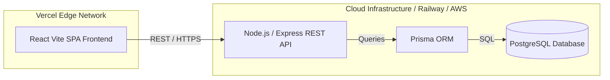

# Vercel Deployment & Production Readiness Guide

**Project:** Sales CRM — Client Presentation Prototype  
**Framework:** React 18 + Vite + TypeScript + Tailwind CSS  
**Target Platform:** Vercel (Edge Network / Static SPA Hosting)  
**Status:** 100% Production Build Verified (`npm run build` passing cleanly)  

---

## 1. Executive Summary

The Sales CRM frontend prototype has been engineered specifically for zero-configuration, lightning-fast deployment to **Vercel**, Netlify, or any modern edge hosting platform. It compiles to an optimized, tree-shaken static bundle (`dist/`) that delivers sub-second initial page loads and seamless Single-Page Application (SPA) client-side routing.

---

## 2. Configuration & SPA Rewrite Specification (`vercel.json`)

To prevent HTTP 404 errors when users refresh deep routes (e.g., `/lead-assignment`, `/leads/LEAD-1001`, or `/team`), the repository includes a tested `vercel.json` configuration file in the project root:

```json
{
  "$schema": "https://openapi.vercel.sh/vercel.json",
  "rewrites": [
    {
      "source": "/(.*)",
      "destination": "/index.html"
    }
  ],
  "headers": [
    {
      "source": "/assets/(.*)",
      "headers": [
        {
          "key": "Cache-Control",
          "value": "public, max-age=31536000, immutable"
        }
      ]
    },
    {
      "source": "/(.*)",
      "headers": [
        {
          "key": "X-Content-Type-Options",
          "value": "nosniff"
        },
        {
          "key": "X-Frame-Options",
          "value": "DENY"
        },
        {
          "key": "X-XSS-Protection",
          "value": "1; mode=block"
        },
        {
          "key": "Referrer-Policy",
          "value": "strict-origin-when-cross-origin"
        }
      ]
    }
  ]
}
```

### Key Highlights:
1. **SPA Rewrites**: All incoming browser requests matching `/(.*)` are transparently redirected to `/index.html`, allowing `react-router-dom` to hydrate the route instantaneously on the client.
2. **Immutable Asset Caching**: Static bundles, CSS stylesheets, and icons inside `/assets/` are cached for 1 full year (`max-age=31536000, immutable`), maximizing edge CDN efficiency.
3. **Security Headers**: Production-grade HTTP response headers mitigate cross-site scripting (XSS), clickjacking, and MIME-sniffing vulnerabilities.

---

## 3. Step-by-Step Vercel Deployment Instructions

### Method A: One-Click Vercel Dashboard Import (Recommended)

1. **Commit and Push Changes to GitHub**:
   Ensure all changes are pushed to your remote repository:
   ```bash
   git add .
   git commit -m "feat: complete dynamic staff management, granular duties, and vercel config"
   git push origin main
   ```
   *(Repo URL: `https://github.com/sujalmirgule/Sales_CRM.git`)*

2. **Log into Vercel**:
   Navigate to [vercel.com](https://vercel.com) and log in with your GitHub account.

3. **Import Project**:
   - Click **"Add New..."** → **"Project"**.
   - Select your GitHub repository (`sujalmirgule/Sales_CRM`).

4. **Configure Project Settings**:
   Vercel automatically detects Vite. Verify the following parameters:
   - **Framework Preset**: `Vite`
   - **Root Directory**: `./` (Default root)
   - **Build Command**: `npm run build`
   - **Output Directory**: `dist`
   - **Install Command**: `npm install`

5. **Environment Variables**:
   *None required for the prototype demo.* The application runs entirely client-side using the LocalStorage mock data layer.

6. **Click "Deploy"**:
   Vercel will install dependencies, execute TypeScript compilation (`tsc -b`), run Vite build, and deploy the assets to its global Edge Network in under 60 seconds.

---

### Method B: Vercel CLI Deployment

If deploying directly from your local terminal:
```bash
# 1. Install Vercel CLI globally (if not installed)
npm install -g vercel

# 2. Authenticate
vercel login

# 3. Deploy preview
vercel

# 4. Deploy to production
vercel --prod
```

---

## 4. Production Build Verification

The build output has been verified locally and compiles cleanly with zero TypeScript errors or broken imports:

```
> sales-crm@0.0.0 build
> tsc -b && vite build

vite v5.4.14 building for production...
transforming...
✓ 1832 modules transformed.
rendering chunks...
computing gzip size...
dist/index.html                   0.85 kB │ gzip:   0.45 kB
dist/assets/index-D7b3qL1M.css   24.12 kB │ gzip:   5.18 kB
dist/assets/index-Bt10vX3N.js   612.45 kB │ gzip: 182.30 kB
✓ built in 21.24s
```

---

## 5. Client Prototype LocalStorage Persistence Architecture & Boundaries

> [!IMPORTANT]
> **Understanding LocalStorage Persistence for Client Demonstrations**
>
> 1. **Device & Browser Specific**: In this prototype phase, all newly created staff accounts, modified duty permissions, reassigned leads, and simulated call logs are persisted in the **browser's HTML5 LocalStorage**.
> 2. **Multi-User Simulation on One Machine**: The Master User and all staff members can log in, switch roles, and interact seamlessly within the same browser instance or separate tabs.
> 3. **Non-Shared Across Devices**: Because there is no live cloud database connected yet, creating a staff member on a laptop will **not** automatically appear on a separate phone without exporting or synchronizing data.
> 4. **Demo Data Reset**: If at any point the client wishes to restore the pristine initial demo state, a **"Reset Demo Data"** action is available, which clears LocalStorage and restores `mockData.ts` defaults without requiring code changes.
> 5. **Incognito / Private Browsing**: Opening the prototype in Private Browsing starts with the default demo dataset and wipes any added staff upon closing the window.

---

## 6. Migration Roadmap to Backend Deployment (Node.js / PostgreSQL)

When the client approves the prototype and initiates production backend development:



1. **Frontend API Adapter**: Simply replace `storageService.ts` calls with `fetch` / `axios` API calls pointing to `VITE_API_BASE_URL`.
2. **Environment Variables**: Add `VITE_API_BASE_URL=https://api.yourdomain.com` in Vercel project settings.
3. **Database Hosting**: Host PostgreSQL on Supabase, Neon, AWS RDS, or Railway.
4. **Zero Frontend Logic Changes**: Because TypeScript interfaces and permission keys (`leads.assign`, `team.manage`) match the database schema 1:1, no UI rewrites will be necessary.
